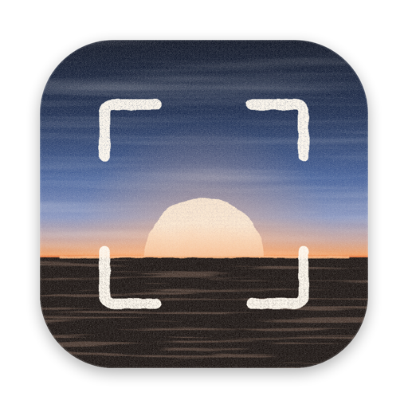
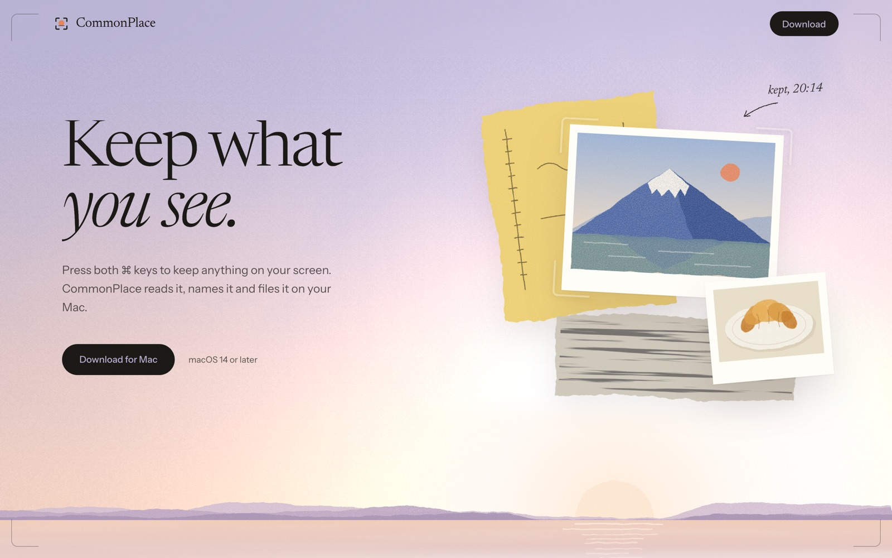
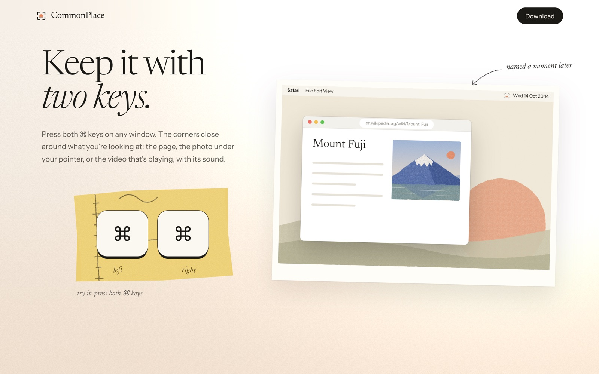
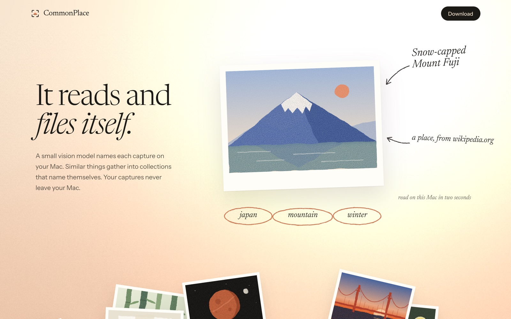
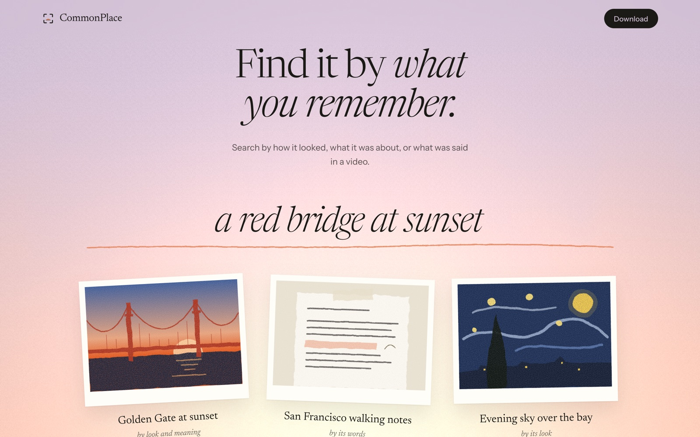

<p align="center">
  
</p>

<h1 align="center">CommonPlace</h1>

<p align="center"><em>Keep what you see.</em></p>

<p align="center">
  <a href="https://atcommonplace.com/download"><strong>Download for Mac</strong></a>
  &nbsp;·&nbsp;
  <a href="https://atcommonplace.com">atcommonplace.com</a>
  &nbsp;·&nbsp;
  macOS 14 or later
</p>

<p align="center">
  
</p>

Press both ⌘ keys to keep anything on your screen. CommonPlace reads it, names it and files it, on your Mac.

People have long kept commonplace books: one notebook for everything worth keeping, so it could be found again. This one keeps itself.

<br>

## Keep it with two keys



Left ⌘ and right ⌘ together, on any window. The corners close around what you're looking at, and a small island drops from under the menu bar with its picture, then its name and collection.

- **The window you're in.** The app's own window, never a toolbar or a pop-up over it.
- **The photo under your pointer.** In a browser, the image itself, at the full size the site has, linked to its page.
- **The video that's playing.** Recorded with its sound until you press the keys again, then transcribed on your Mac.
- **Photos and videos you already have.** Drop them on the library, choose Import, or pick from Photos.

<br>

## It reads and files itself



A small vision model in Ollama gives each capture a title, a summary, its kind and topics, and the passages worth keeping. It is checked against what is really on the screen, so nothing is invented. Similar things gather into collections that name themselves and rename as they grow.

<br>

## Find it by what you remember



Search by how it looked, what it was about, or what was said in a video: "that bridge in San Francisco", "how to refund a payment", "a walk in a bamboo forest". Each result says why it came up, and a collection the search finds whole comes first.

<br>

## Your agents can ask it

CommonPlace ships an MCP server. Claude Code, Codex or any MCP client can search what you kept and read its text, never its images. Nothing runs until you add it.

```bash
claude mcp add commonplace -- /Applications/CommonPlace.app/Contents/MacOS/commonplace-mcp
```

Tools: `search_commonplace(query, limit?)`, `recent_captures(limit?, collection?, kind?)`, `get_capture(id)`, `list_collections()`.

<br>

## Private by construction

Screenshots, text, vectors and the library stay in `~/Library/Application Support/CommonPlace`. The models run in Ollama on your Mac. There is no account and no cloud; your captures never leave your Mac.

Once a day the app sends a check-in: a random install ID, the app and macOS versions, and how many things were kept, as a number. It tells us how many Macs use CommonPlace and nothing about what is on them. The server counts the ID only in HyperLogLogs, which give unique counts and cannot be read back, and keeps no IP addresses. Turn it off in Settings and nothing is sent.

<br>

## Install

1. [Download CommonPlace](https://atcommonplace.com/download) and move it to Applications.
2. Install [Ollama](https://ollama.com/download) 0.40 or later.
3. Open CommonPlace. Setup asks for Screen Recording (to take the picture) and Accessibility (to hear the keys and read a page's address), and downloads the two models, about 4 GB: Qwen 3.5 4B (2B on Macs with less than 16 GB) and EmbeddingGemma 2.

Settings has the capture keys (both ⌘, both ⌥, or ⌃⌥⌘K), the vision model, the library on disk, open at login, the daily check-in, and how to connect agents.

<br>

## Build from source

```bash
swift test                    # the core: store, capture rules, parsing, organizing, search, check-in
./scripts/build-app.sh        # dist/CommonPlace.app, signed with your Developer ID when the keychain has one
node --test site/test/*.test.js   # the website's counters
```

`cp-eval` runs the real pipeline over a folder of screenshots and reports titles, kinds, collections, similarities and search results. The thresholds in the code were set with it.

```bash
swift run cp-eval ~/screens manifest.tsv --query "volcano in japan" --query "coffee"
```

### How it works

| Step | What happens | Where |
|---|---|---|
| Keep | Both keys (`BothSidesGesture`), then the window the focused window overlaps most (`WindowChoice`), captured at full resolution with ScreenCaptureKit, with the page address from Accessibility | `Capture/` |
| In a page | What is under the pointer: an image becomes a photo of its page, a video a recording with sound | `PageTarget`, `PagePointer`, `VideoRecorder` |
| Read | Apple Vision text recognition | `Reader` |
| Describe | Qwen 3.5 returns a title, summary, kind, tags, highlights and links, checked against the screen | `Describer` |
| Embed | EmbeddingGemma 2, twice: *look* (the picture with its text) for search, *meaning* (title and topics) for collections | `EmbeddingText` |
| File | The nearest collection, or a new one with similar unsorted captures, named by the model as it grows | `Organizer`, `CollectionNamer` |
| Find | The query against look and meaning (each query's stand-outs) and FTS5 words, merged by reciprocal rank; a collection mostly found is completed | `SearchMerge` |
| Import | Photos upright with their taken date; videos become a poster, a six-frame contact sheet and an on-device transcript | `MediaImporter`, `Transcriber` |
| Agents | MCP over stdio, text only | `MCPServer`, `commonplace-mcp` |

A capture is kept the moment you press the keys. Understanding runs in the background and picks up again whenever Ollama is back.

### The repository

| | |
|---|---|
| `Sources/CommonPlaceKit` | Everything that needs no screen: the store, capture rules, Ollama, understanding, organizing, search, the check-in |
| `Sources/CommonPlace` | The menu bar app: capture, the island, the library, Setup and Settings |
| `Sources/commonplace-mcp` | The MCP server, bundled in the app |
| `Sources/cp-eval` | The evaluation tool |
| `Resources` | Info.plist, the icon, the bundled fonts, the hand-drawn art and its SVG sources |
| `site` | atcommonplace.com: a static page, the counters (`site/api`) and their tests |
| `scripts` | `build-app.sh` builds and signs the app; `render-art.sh` renders the art and the icon from their sources |

The website runs on Vercel. Its counters need an Upstash Redis store (`KV_REST_API_URL`, `KV_REST_API_TOKEN`) and a `STATS_TOKEN` for the private numbers page.

<br>

## Credits

Type: [Fraunces](https://github.com/undercasetype/Fraunces) and [Inter](https://github.com/rsms/inter) in the app, Newsreader and Instrument Sans on the website, all under the SIL Open Font License (the licences are in `Resources/Fonts`). Models: Qwen 3.5 and EmbeddingGemma 2, run by [Ollama](https://ollama.com). The art is drawn in code, in SVG.

CommonPlace is released under the [MIT License](LICENSE).
